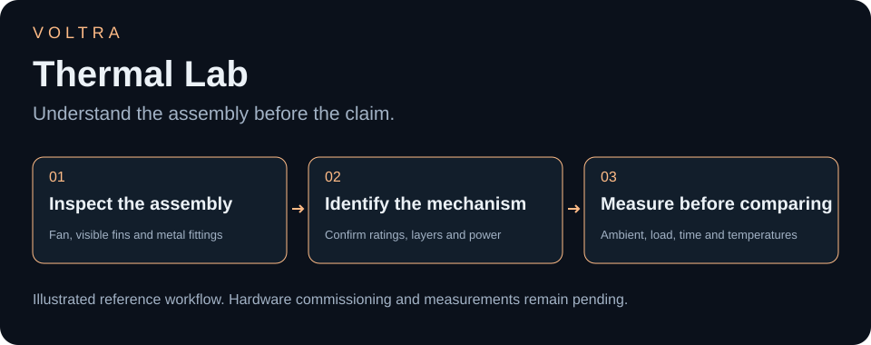
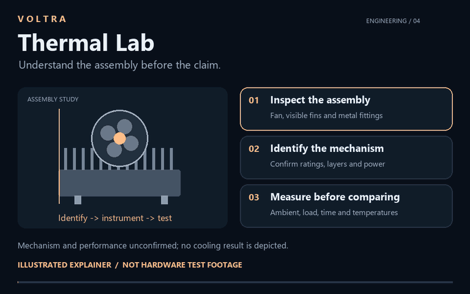
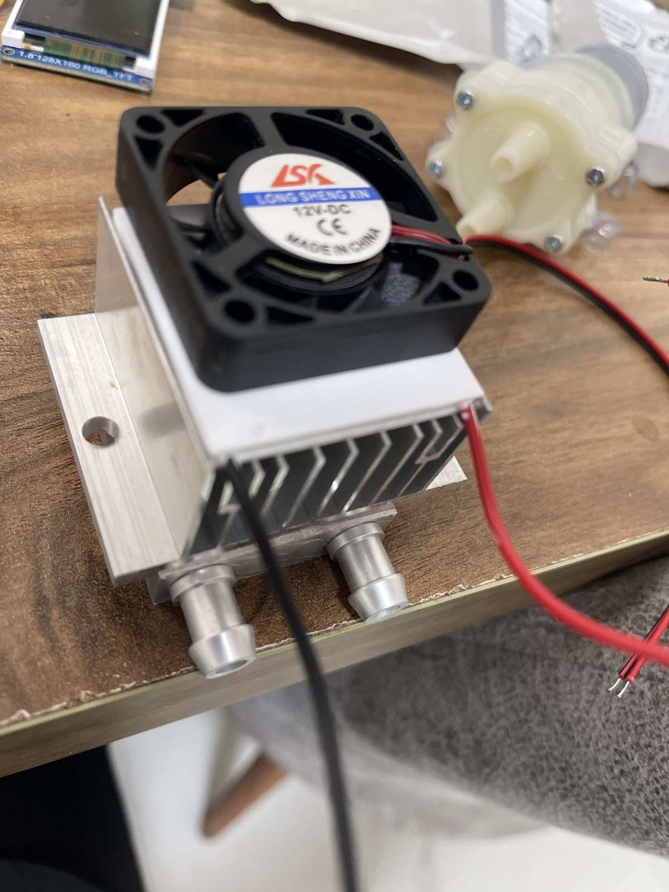

# VOLTRA Thermal Lab

### Making the thermal assembly visible—not just the temperature claim.

## See the engineering approach

[Watch or download the 12-second explainer](media/walkthrough.mp4). A silent, illustrative inspection sequence—not a thermal simulation, airflow measurement or working-device video. The thermal mechanism remains unconfirmed; no temperature or cooling result is invented.

## The real prototype

Thermal engineering lives in the details of the physical build. This compact assembly brings a **DC fan, a finned heatsink, and a metal section with two visible fittings** into a real bench prototype. The photograph makes the construction inspectable; the next engineering step is to identify its thermal mechanism and measure its behavior under defined conditions.

[Components](#what-can-be-identified) · [Technology review](#technology-and-purpose-confirmation-required) · [Hardware checklist](WIRING_AND_SOURCE.md)

## Engineering focus

The assembly offers a concrete starting point for documenting mechanical contact, airflow, power delivery, and—if the fittings are used for circulation—the actual flow path. Each belongs in the build record once confirmed. A fan's presence alone is not a thermal-performance result.

## What can be identified

| Visible component | Quantity | Evidence |
| --- | --- | --- |
| DC fan | 1 | Label reads 12V DC; this is not a measured operating voltage |
| Finned heatsink | 1 visible assembly | Visible beneath the fan |
| Metal section with fittings | 1 visible assembly; 2 fittings | Internal flow path and purpose unconfirmed |
| Power leads | Present | Actual supply and electrical connections unknown |

The nearby plastic pump-like unit and TFT are background items until their relationship to the assembly is confirmed. No component identity is inferred merely from proximity.

## Technology and purpose: confirmation required

The photograph alone cannot establish whether the system uses a thermoelectric element, liquid circulation, passive heat spreading, or another arrangement. No Peltier/TEC model, coolant specification, heat-load rating, thermal resistance, or achieved temperature is claimed.

## A useful next test

Document the exact stack and power connections first. Record ambient temperature, measurement locations, supply voltage/current, load, elapsed time, and steady-state temperature before comparing configurations. Include a photograph or video of the actual setup and raw measurements.

No matching control firmware, wiring schematic, thermal log, or performance test was located. Assembly and powering instructions remain withheld until the technology and component ratings are identified.

The owner confirms that this photograph represents an independent project. See the [hardware and source checklist](WIRING_AND_SOURCE.md). This may be a hardware-only build: firmware should not be invented merely to add a code folder.

Project author: [ali9235](https://github.com/ali9235). Physical hardware study; component identification and measured thermal results remain pending.
