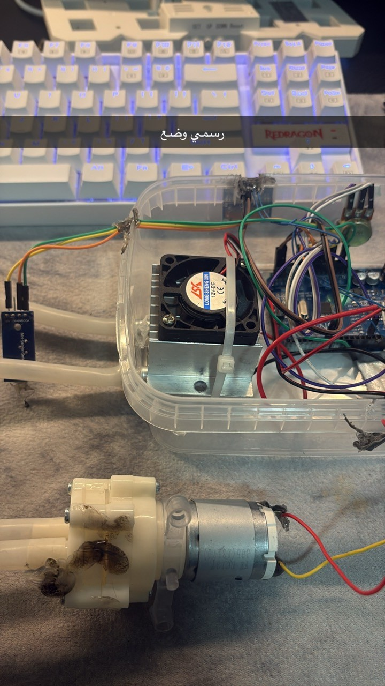
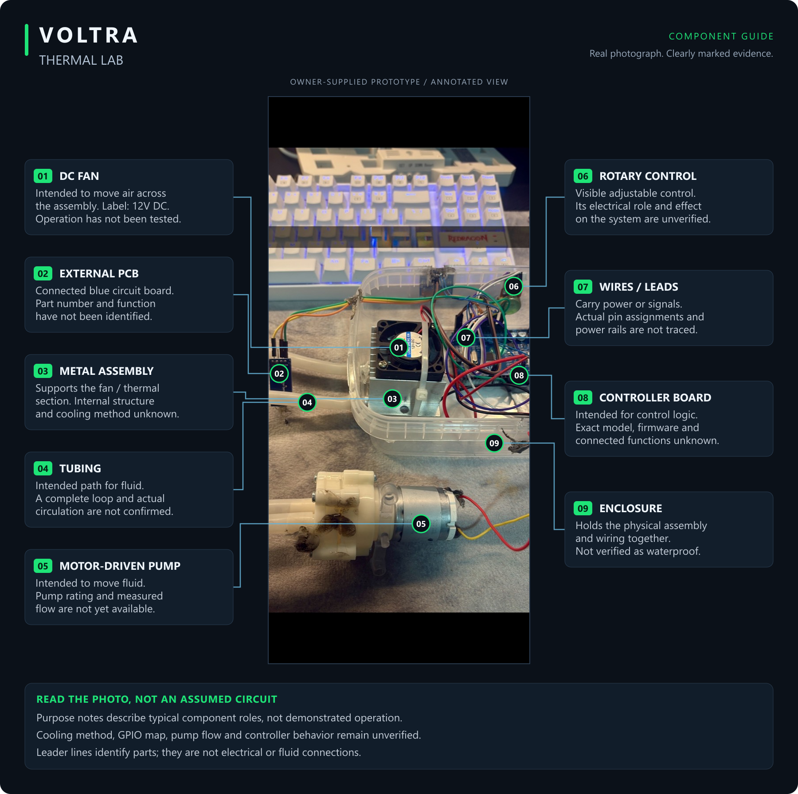

<h1 align="center">VOLTRA</h1>
<h2 align="center">Thermal Lab</h2>

### Making the thermal assembly visible—not just the temperature claim.

## See the engineering approach

[Watch or download the 12-second explainer](media/walkthrough.mp4). A silent, illustrative inspection sequence—not a thermal simulation, airflow measurement or working-device video. The thermal mechanism remains unconfirmed; no temperature or cooling result is invented.

## The real prototype

Thermal engineering lives in the details of the physical build. The updated photograph brings the wider experiment into view: a **12V-labelled DC fan on a metal assembly, a controller board inside a translucent enclosure, and a separate motor-driven pump with tubing**. It documents the physical integration; it does not establish the cooling mechanism, a complete circulation path, or thermal performance.

[Earlier assembly photograph](images/prototype.jpg) · The latest owner-supplied photograph is preserved as provided, without generative editing.

## What each part does

[Open the full-size component guide](media/component-guide.png) · [Editable SVG version](media/component-guide.svg)

The second image labels the visible fan, metal assembly, pump, tubing, wiring, enclosure, controller, rotary control and external PCB. Purpose notes describe typical component roles, not verified system operation. Unknown models and functions are marked explicitly; the leader lines are **not a wiring or fluid schematic**. The real photograph embedded in the guide is unchanged.

[Components](#what-can-be-identified) · [Technology review](#technology-and-purpose-confirmation-required) · [Hardware checklist](WIRING_AND_SOURCE.md)

## Engineering focus

The assembly offers a concrete starting point for documenting mechanical contact, airflow, power delivery, and—if the fittings are used for circulation—the actual flow path. Each belongs in the build record once confirmed. A fan's presence alone is not a thermal-performance result.

## What can be identified

| Visible component | Quantity | Evidence |
| --- | --- | --- |
| DC fan | 1 | Label reads 12V DC; this is not a measured operating voltage |
| Metal fan/thermal assembly | 1 | Wider enclosure view in the new image; fins and two fittings visible in the earlier image |
| Arduino-format controller board | 1 partly visible | Exact board/MCU and firmware unconfirmed |
| Motor-driven pump with tubing | 1 visible pump assembly | Model, rated voltage, flow and connection to the thermal block unverified |
| Translucent enclosure and bundled wiring | 1 assembly | Exact signal/power connections not traceable from the photograph |
| Small external blue circuit/module | 1 visible | Function and part number unconfirmed |
| Power leads | Present | Actual supply and electrical connections unknown |

The owner assigns the new photograph to this cooling project. The visible pump and tubes are documented as part of the photographed experiment; a closed-loop circuit, active pumping, temperature sensing and controller behavior are not proven. The TFT in the earlier photograph is not automatically part of this assembly.

## Technology and purpose: confirmation required

The photograph alone cannot establish whether the system uses a thermoelectric element, liquid circulation, passive heat spreading, or another arrangement. No Peltier/TEC model, coolant specification, heat-load rating, thermal resistance, or achieved temperature is claimed.

## A useful next test

Document the exact stack and power connections first. Record ambient temperature, measurement locations, supply voltage/current, load, elapsed time, and steady-state temperature before comparing configurations. Include a photograph or video of the actual setup and raw measurements.

No matching control firmware, wiring schematic, thermal log, or performance test was located. A controller is visible, but no code is attributed to it without a matching sketch. Assembly and powering instructions remain withheld until the technology and component ratings are identified.

The owner confirms that the photographs represent one independent cooling project. See the [hardware and source checklist](WIRING_AND_SOURCE.md). The controller's actual function must be established before implementing a driver or calling this a closed-loop thermal-control system.

Project author: [ali9235](https://github.com/ali9235). Physical hardware study; component identification and measured thermal results remain pending.
