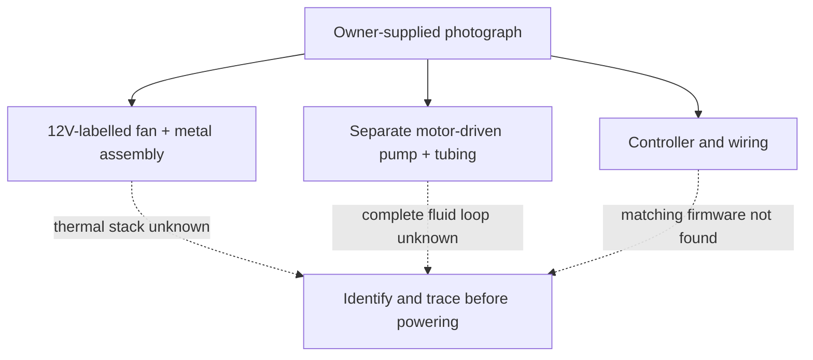

# VOLTRA Thermal Lab: architecture and technical deep dive

Make a real thermal assembly inspectable before claiming cooling performance. Photos support physical integration; the thermal mechanism and complete electrical/fluid paths still need identification.

## System boundary

Solid arrows show implemented software flow or observed grouping. Dashed arrows identify optional, disabled or unverified paths. Neither is a recovered wiring schematic.

## Architecture evidence, not an inferred circuit

This diagram records visible grouping and unresolved interfaces. It is not a power schematic, control signal path or verified circulation loop. A 12V fan label is not a measured supply and says nothing about the pump's required voltage.

| Evidence | Supports | Does not establish |
| --- | --- | --- |
| [Real photographs](../README.md#the-real-prototype) | Fan/metal, pump/tubing and controller integration | Powered cooling, flow, identities or wiring |
| [Component guide](../media/component-guide.png) | Locations and typical roles | Electrical or fluid connectivity |
| [Source checklist](../WIRING_AND_SOURCE.md) | Missing facts to collect | A recovered sketch |

## Software and data contract

No matching firmware, thermal algorithm, API or sensor-data format was found. There is no controller software architecture to attribute to this prototype. The explainer animation describes an investigation process, not a simulation or real test.

A valid thermal record needs ambient temperature, probe type/calibration/location, applied load, supply voltage/current, elapsed time and raw temperature samples. Identify the complete heat path and any fluid path before interpreting changes. A heatsink or pump alone cannot identify a Peltier element.

## Operating boundary

Do not power unknown modules using guessed connections. Establish ratings, polarity, protection and isolation first. There is no legitimate firmware command or reproducible thermal operating procedure until those facts are available.

## Evidence boundary

No matching firmware, powered demonstration, thermal results, flow rate or efficiency measurement is available.

[Documentation index](ENGINEERING_STANDARD.md) · [Design decisions](DECISIONS.md) · [Security](../SECURITY.md)
